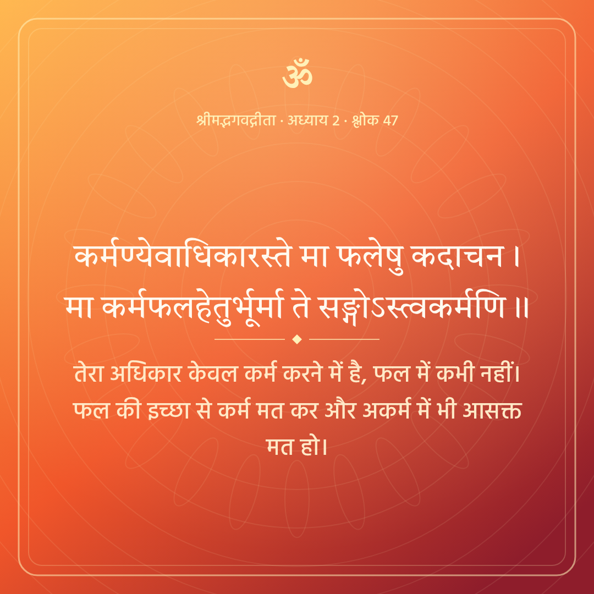
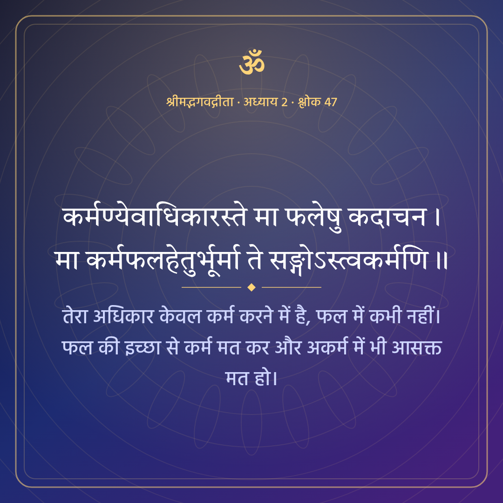
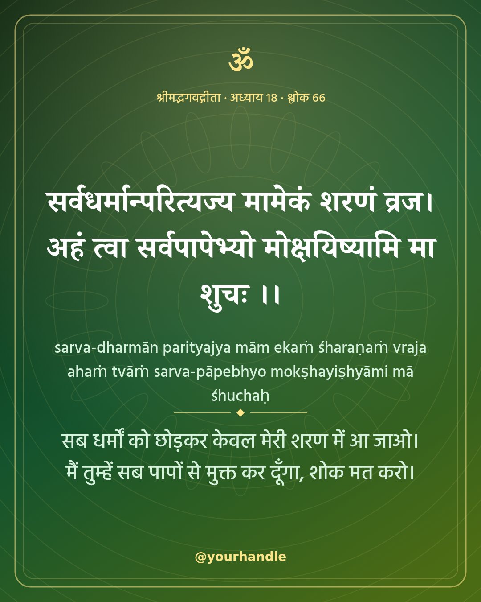
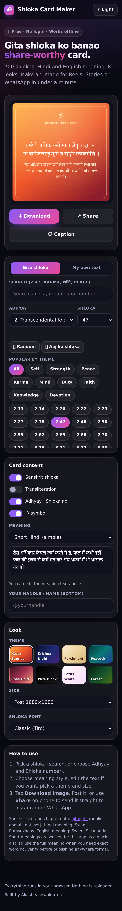

# Gita Shloka Card Maker

Make clean, shareable image cards from any of the 700 Bhagavad Gita shlokas, with Hindi or English meaning. Built for Reels, Stories and WhatsApp. Free, no login.

## Screenshots







## Features

- All 700 shlokas searchable by number, word or meaning
- 55 popular shlokas with short Hindi and English gists, grouped by theme
- Full Hindi (Swami Ramsukhdas) and English (Swami Sivananda) meaning, editable before download
- 8 themes, 3 sizes (post 1080x1080, portrait 1080x1350, story 1080x1920), 3 shloka fonts
- "My own text" mode for quotes
- Download PNG, share sheet on phone, copy ready caption with hashtags
- Dark and light mode, mobile and desktop

## How to use

1. Pick a shloka or search.
2. Choose meaning style, theme and size. Edit the text if needed.
3. Download the image or tap Share.

## Honest limits

- Short meanings are written for this app as a quick gist for 55 verses. Use the full meaning when you need exact wording.
- Sanskrit text comes from the public domain gita/gita dataset. Check wording before formal publication.
- Long meanings shrink the text or get shortened on the card. Short meaning looks best.

## Tech and privacy

Plain HTML, CSS and JavaScript with Canvas. Bundled open fonts (Tiro Devanagari Hindi, Noto Serif Devanagari, Hind; SIL OFL). No backend. Everything runs in your browser. Nothing you type is uploaded. Installable as a PWA and works offline after the first visit.

## Run locally

```bash
git clone <this repo>
cd <folder>
python3 -m http.server 8000
# open http://localhost:8000
```

## Deploy free

GitHub Pages: Settings, Pages, Deploy from branch `main`, folder `/ (root)`.

## Author

Built by Akash Vishwakarma.
